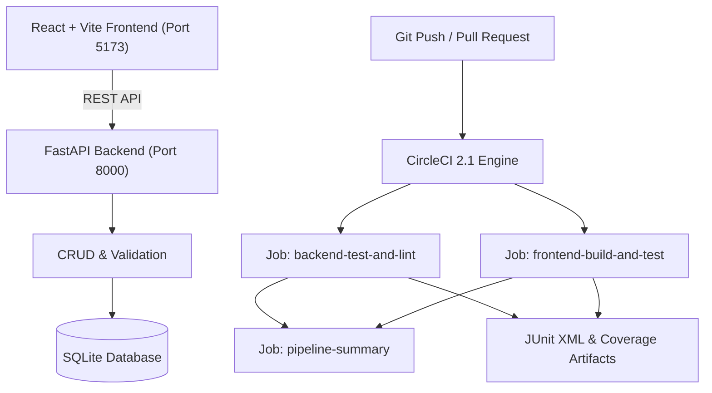

# Continuous Integration and Testing Pipeline Using CircleCI

[](https://circleci.com)
[](https://www.python.org/)
[](https://fastapi.tiangolo.com)
[](https://reactjs.org/)
[](https://vitejs.dev/)
[](https://tailwindcss.com/)
[](https://docs.pytest.org/)
[](https://docs.astral.sh/ruff/)

An academic and production-ready DevOps course project implementing a **Task Management REST API** and an automated **Continuous Integration & Testing Pipeline** using GitHub, CircleCI, Pytest, and Vitest.

---

## 📋 Table of Contents
1. [Project Overview](#-project-overview)
2. [Technology Stack](#-technology-stack)
3. [Architecture Overview](#-architecture-overview)
4. [Project Structure](#-project-structure)
5. [Quickstart: Local Development](#-quickstart-local-development)
6. [Automated Testing & Quality Checks](#-automated-testing--quality-checks)
7. [CircleCI Pipeline Configuration](#-circleci-pipeline-configuration)
8. [Docker & Containerization](#-docker--containerization)
9. [Git Workflow & Integration](#-git-workflow--integration)
10. [Documentation Index](#-documentation-index)

---

## 🌟 Project Overview

This project demonstrates the core engineering practices of Continuous Integration (CI):
- **FastAPI REST API**: Comprehensive CRUD endpoints for task management with schema validation and error responses.
- **Automated Pytest Suite**: 24 rigorous test cases covering creation, filtering, pagination, updates, deletions, and edge-case error validation.
- **Modern React Dashboard**: Full-featured UI featuring real-time statistics, search, filters, task progression, and a secure CI pipeline status modal.
- **CircleCI Workflows**: Multi-job DAG pipeline with dependency caching, parallel execution, JUnit XML test reporting, and artifact storage.
- **Containerization**: Production Dockerfiles and Docker Compose orchestration.

---

## 🛠 Technology Stack

| Layer | Technologies |
|---|---|
| **Backend** | Python 3.11 / 3.14, FastAPI, Pydantic v2, SQLAlchemy 2.0, Uvicorn |
| **Testing & Quality** | Pytest 9.1, Pytest-Cov, HTTPX / TestClient, Ruff Linter |
| **Frontend** | React 18, Vite 6, Tailwind CSS 3, Lucide React, Vitest 3 |
| **CI/CD Platform** | CircleCI 2.1 (Docker Executors `cimg/python`, `cimg/node`) |
| **Containerization** | Docker, Docker Compose, Nginx Alpine |
| **SCM & Versioning** | Git, GitHub |

---

## 🏛 Architecture Overview



Detailed diagrams and sequence flows can be found in [docs/ARCHITECTURE.md](docs/ARCHITECTURE.md).

---

## 📂 Project Structure

```
devops/
├── .circleci/
│   └── config.yml               # CircleCI 2.1 pipeline configuration
├── backend/
│   ├── app/
│   │   ├── config.py            # Environment settings
│   │   ├── database.py          # SQLAlchemy engine & session dependency
│   │   ├── models.py            # SQLAlchemy Task ORM model
│   │   ├── schemas.py           # Pydantic v2 request/response schemas
│   │   ├── crud.py              # Database queries & stats aggregation
│   │   ├── routers/
│   │   │   ├── tasks.py         # Task CRUD & stats endpoints
│   │   │   └── health.py        # Health probe & CircleCI proxy
│   │   └── main.py              # FastAPI app initialization & CORS
│   ├── tests/
│   │   ├── conftest.py          # Isolated in-memory SQLite fixtures
│   │   └── test_tasks.py        # 24 Pytest automated test cases
│   ├── Dockerfile               # Production backend container spec
│   ├── pytest.ini               # Pytest & JUnit XML configuration
│   ├── requirements.txt         # Production dependencies
│   ├── requirements-dev.txt     # Test & linter dependencies
│   └── ruff.toml                # Ruff code quality rules
├── frontend/
│   ├── src/
│   │   ├── components/          # Header, Stats, Cards, Modals, Toasts
│   │   ├── api.js               # Backend API client with error handling
│   │   ├── App.jsx              # Main dashboard application
│   │   ├── App.test.jsx         # Vitest frontend tests
│   │   └── index.css            # Tailwind styles & glassmorphism
│   ├── Dockerfile               # Multi-stage Nginx container build
│   ├── nginx.conf               # SPA routing & API reverse proxy
│   └── vite.config.js           # Vite dev server & proxy settings
├── docs/                        # Complete technical documentation suite
│   ├── ARCHITECTURE.md          # System design & Mermaid diagrams
│   ├── API_SPECIFICATION.md     # OpenAPI REST documentation
│   ├── CI_CD_PIPELINE.md        # CircleCI job & caching breakdown
│   ├── TESTING_REPORT.md        # Test results & failure demo report
│   ├── VIVA_QUESTIONS.md        # DevOps oral exam preparation
│   └── CHECKLIST.md             # Deliverables & next steps checklist
├── scripts/
│   └── validate_circleci.py     # CircleCI config schema validator
├── docker-compose.yml           # Unified multi-container orchestration
└── .gitignore                   # Ignores venv, node_modules, artifacts
```

---

## 🚀 Quickstart: Local Development

### 1. Run the FastAPI Backend

```bash
# Navigate to backend directory
cd backend

# Create and activate Python virtual environment
python3 -m venv venv
source venv/bin/activate

# Install dependencies
pip install -r requirements-dev.txt

# Start backend server
uvicorn app.main:app --reload --host 0.0.0.0 --port 8000
```
- API will be accessible at: `http://localhost:8000`
- Swagger UI Documentation: `http://localhost:8000/docs`
- Health check: `http://localhost:8000/health`

### 2. Run the React Frontend

```bash
# In a new terminal window:
cd frontend

# Install Node dependencies
npm install

# Start Vite development server
npm run dev
```
- Frontend will be accessible at: `http://localhost:5173`

---

## 🧪 Automated Testing & Quality Checks

### Run Backend Pytest Suite
```bash
cd backend
source venv/bin/activate

# Execute all 24 tests and generate JUnit XML & Coverage report
pytest
```
*Result:* **24 passed in 0.16s** with JUnit XML saved to `backend/test-results/junit.xml`.

### Run Ruff Code Quality Linter
```bash
cd backend
source venv/bin/activate
ruff check app tests
```
*Result:* **All checks passed (0 errors)**.

### Run Frontend Vitest Suite
```bash
cd frontend
npm test
```
*Result:* **1 test passed** with JUnit report saved to `frontend/test-results/junit.xml`.

### Validate CircleCI Configuration Locally
```bash
python3 scripts/validate_circleci.py
```
*Result:* **CircleCI configuration is structurally sound and completely valid!**

---

## 🔄 CircleCI Pipeline Configuration

The pipeline is defined in `.circleci/config.yml` with three coordinated jobs:

1. **`backend-test-and-lint`**:
   - Runs on `cimg/python:3.11`.
   - Restores cached Python wheels.
   - Executes `ruff check app tests`.
   - Runs `pytest` generating `junit.xml` and `coverage.xml`.
   - Executes `store_test_results` and `store_artifacts`.

2. **`frontend-build-and-test`**:
   - Runs on `cimg/node:20.18`.
   - Restores cached `node_modules`.
   - Runs Vitest unit tests.
   - Executes `npm run build` to verify production compilation.
   - Stores build artifacts and test reports.

3. **`pipeline-summary`**:
   - Requires both upstream jobs to succeed.
   - Acts as the definitive commit quality gate.

---

## 🐳 Docker & Containerization

To run the entire platform locally with containerization:

```bash
# Build and start both containers
docker-compose up --build

# Run in background (detached)
docker-compose up -d

# Check running status and healthchecks
docker-compose ps

# Stop containers
docker-compose down
```
- Frontend UI: `http://localhost:3000`
- Backend API: `http://localhost:8000`

---

## 🌿 Git Workflow & Integration

### Initialize and Commit
```bash
# Initialize git repository
git init

# Stage all files
git add .

# Create initial commit
git commit -m "feat: complete TaskOps REST API, Pytest suite, and CircleCI pipeline"
```

### Feature Branching & Pull Requests
```bash
# Create and switch to a feature branch
git checkout -b feature/task-priority-filter

# Make code changes, run tests, and commit
git add .
git commit -m "feat: add priority filter to task query"

# Push feature branch to GitHub
git push -u origin feature/task-priority-filter

# Open a Pull Request on GitHub and observe automated CircleCI status checks!
```

---

## 📚 Documentation Index

- 📐 [docs/ARCHITECTURE.md](docs/ARCHITECTURE.md) — System architecture, database isolation, and Mermaid sequence flows.
- 📡 [docs/API_SPECIFICATION.md](docs/API_SPECIFICATION.md) — Complete REST API reference, request/response models, and status codes.
- ⚙️ [docs/CI_CD_PIPELINE.md](docs/CI_CD_PIPELINE.md) — Comprehensive CircleCI configuration guide, caching, and setup steps.
- 📊 [docs/TESTING_REPORT.md](docs/TESTING_REPORT.md) — Automated testing report, code coverage metrics, and controlled failure demonstration.
- 🎓 [docs/VIVA_QUESTIONS.md](docs/VIVA_QUESTIONS.md) — Academic viva questions & answers for DevOps and CI/CD examinations.
- ✅ [docs/CHECKLIST.md](docs/CHECKLIST.md) — Complete deliverable verification checklist.
