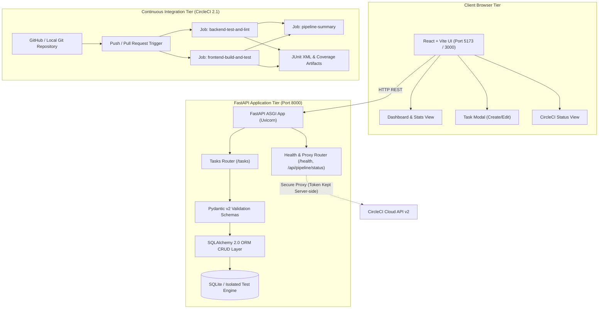
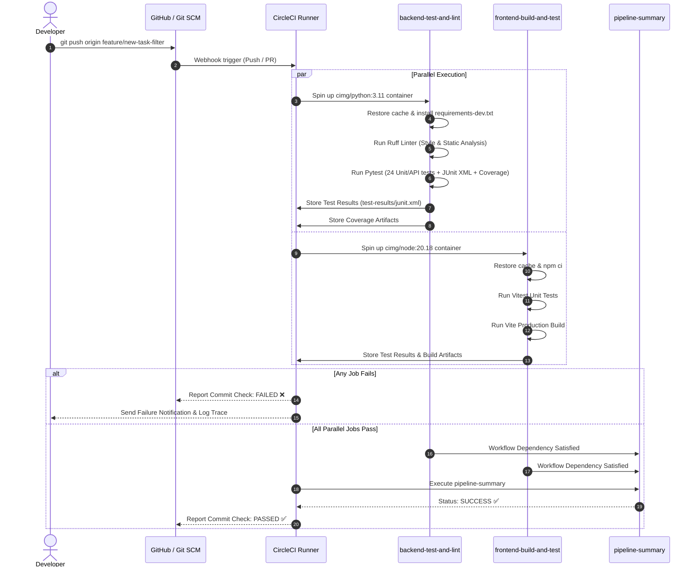

# Project Architecture & System Design

## 1. System Overview

**TaskOps** is a full-stack, DevOps-engineered Task Management platform with an automated Continuous Integration and Continuous Testing pipeline built on CircleCI.

The system is decoupled into three core tiers:
1. **Frontend Presentation Layer**: Built with React 18, Vite, and Tailwind CSS. Provides an intuitive dashboard, task statistics, interactive filtering, and a secure CI pipeline status modal.
2. **Backend Application Layer**: Built with Python and FastAPI. Implements RESTful CRUD endpoints for tasks, strict Pydantic schemas, database transactions, health probes, and a server-side CircleCI API proxy.
3. **Continuous Integration & Testing Engine**: Powered by CircleCI, Pytest, Ruff, and Vitest. Automates code checkout, caching, linting, regression testing, JUnit XML report generation, and artifact archiving.

---

## 2. Architecture Diagram

---

## 3. CI/CD Pipeline Workflow Diagram

---

## 4. Key Design Decisions

### A. Isolated Database Storage
- For production/development, the application uses SQLite (`tasks.db`), avoiding external heavy database dependencies while maintaining full ACID guarantees.
- For automated testing (`conftest.py`), SQLite in-memory with `StaticPool` is initialized fresh for every test run, guaranteeing 100% test isolation, eliminating flaky dependencies, and enabling rapid parallel execution (under 0.20 seconds for 24 test cases).

### B. Secure Pipeline Status Proxy
- Exposing CircleCI personal API tokens in the React client would pose a severe security vulnerability.
- To satisfy the optional pipeline monitoring requirement safely, the FastAPI backend provides a server-side proxy endpoint (`/api/pipeline/status`). The secret `CIRCLECI_TOKEN` remains on the server, and the frontend consumes sanitized JSON. If tokens are not set, a descriptive configuration prompt is returned without failing.

### C. JUnit XML Test Results Standardization
- CircleCI's native test dashboard parses JUnit-compatible XML test results.
- Pytest is configured via `pytest.ini` (`--junitxml=test-results/junit.xml`, `junit_family=xunit2`).
- Vitest is configured with `@vitest/junit-reporter` (`--reporter=junit --outputFile=test-results/junit.xml`).
- This enables CircleCI to highlight flaky tests, pinpoint failures per line of code, and compute execution metrics across builds.
